# 📰 CrossbarPuzzles: The Weekly Football Paper for Kids

**One printable page a week. Real Premier League stats and puzzles. No screen needed.**

**[Live site: crossbarpuzzles.com](https://www.crossbarpuzzles.com)** 
[How it works](#-how-it-works) · [The agents](#-the-agents) · [For judges](#-for-judges-verify-it-in-5-minutes)

> Built for the Microsoft *Inside the Game* Developer Hackathon.

---

## ⚡ Elevator pitch

**CrossbarPuzzles is a weekly, one-page printable football newspaper that lets kids follow the Premier League without a screen.** An **Azure Function** proxy fetches match data from a CC0 public-domain Kaggle dataset. A **builder agent in Microsoft Foundry** uses that proxy as an OpenAPI tool to write each week's edition and commit it to `main`. A separate **verifier agent** reviews the update and is the only route to `production`, which **GitHub Actions** deploys to **Azure Static Web Apps**. We started with synthetic match data, but young testers weren't interested in it and couldn't give useful feedback, so we rebuilt around real results. That matters especially in the USA, where newspapers rarely print Premier League stats.

---

## The problem

- **Following football means screens.** For kids, that usually means apps, autoplay highlights and notifications. And then the distractions come.
- **US sports pages skip the Premier League.** In England, every paper prints the table. In the USA, the sports pages are full of the NFL, NBA and MLB. A young American fan who gets up early for a Saturday kick-off has nothing to read about it on paper.
- **Kids enjoy puzzles about things they care about.** A maths worksheet is a chore. Working out the league leader's points is a challenge.

**CrossbarPuzzles fills that gap.** Parents print one page, and the child gets the table, the results, next week's fixtures and three puzzles, all built from this week's real numbers.

---

## What we learned: synthetic data didn't engage kids

We started where the hackathon starts: **synthetic, football-realistic data.** The prototype is still in this repo and available [Live site: crossbarpuzzles.com/synthetic-data-mockup.html](https://www.crossbarpuzzles.com/synthetic-data-mockup.html) the project had a different working title at the time.

- [`synthetic-data/synthetic-match.json`](synthetic-data/synthetic-match.json) is a generated, event-level match with **3,777 events**, including 1,038 passes, 740 carries, 343 pressure events and 43 shots, with fictional players and line-ups.
- [`public/synthetic-data-mockup.html`](public/synthetic-data-mockup.html) is the printable sheet we built from synthetic data, with top finishers, assist leaders, goalkeepers and puzzles.

**Then we tested it with kids.** They weren't interested in made-up matches with synthetic players, and because they didn't care. they couldn't tell us what worked. A fictional 3-1 win that never happened wasn't interesting. The made-up names overpowered any statistics that were generated. The logic behind using synthetic data was too abstract and that became the focus of conversations.

**Real results changed that.** The page was redesigned to use data that was safely in the public domain with no privacy concerns. With just factual data, engagement changed. The concept worked. The puzzles were interesting and students could gather their own insights into the table. They could track future matches and make their own predections.

> **Key finding:** with kids, engagement drives feedback. Synthetic data produced neither, and real data produced both, so the weekly paper uses real CC0 data. The synthetic prototype stays in the repo as the starting point of the design.

---

## 🗞️ What's on the page

Everything fits on **one A4 (or 8.5 x11) landscape page** and prints in black and white. (Or color)

| Section | What it shows | What kids practise |
|---|---|---|
| **Power ratings** | Attack and defence for all 20 clubs against an average side (1.00 = average). Rating = Att ÷ Def | Ratios and comparing numbers |
| **Next 3 games** | The hardest and kindest upcoming runs, using the average rating of the three opponents | Averages |
| **Matchweek results** | Each score with the model's pre-match chance of that result, plus 🚨 **SHOCK** flags | Probability as a percentage |
| **Predict the next matchweek** | UK kick-off times, home/draw/away chances, xG and a likely score. Kids write their own predictions in boxes: 3 points for an exact score, 1 for the right result | Estimating and keeping score |
| **Puzzle 1 · Stadium Match** | Match 10 clubs to their grounds, with capacities shown | Memory and large numbers |
| **Puzzle 2 · Top of the Table** | Work out the leader's blank row from the column totals | Subtraction and working backwards |
| **Puzzle 3 · Club Word Search** | Find one word for each of the 20 clubs | Spelling and pattern spotting |

The page computes all statistics and puzzles in the browser from four small data files. The agents never hand-write the numbers on the page.

---

## 🏗️ How it works

```mermaid
flowchart LR
  K["Kaggle dataset<br/>2026-27 Premier League<br/>(CC0)"] --> F["Azure Function<br/>kaggle-proxy"]
  F -->|"OpenAPI tool"| B["Builder agent<br/>(Microsoft Foundry)"]
  B -->|"commits 4 data files"| M["main branch"]
  M --> V["Verifier agent<br/>(Microsoft Foundry)"]
  V -->|"PROMOTE: merge PR"| P["production branch"]
  V -->|"REJECT / HOLD: report only"| M
  P --> GA["GitHub Actions"]
  GA --> S["Azure Static Web Apps<br/>crossbarpuzzles.com"]
  S --> PR["🖨️ one printed page"]
```



| Stage | Where | What happens |
|---|---|---|
| **Ingest** | [`kaggle-proxy/function_app.py`](kaggle-proxy/function_app.py) | The Azure Function downloads one of five allowed CSV files from Kaggle on the server, follows the signed-storage redirect, unzips the file if needed and returns plain CSV. The Kaggle token lives in an app setting, never in the browser or the repo. |
| **Expose as a tool** | [`openapi/premier_league_proxy_openapi.json`](openapi/premier_league_proxy_openapi.json) | An OpenAPI 3.0 spec lets Foundry agents call the proxy as the tool `downloadPremierLeagueFile`. |
| **Build** | [`agents/builder/instructions.md`](agents/builder/instructions.md) | The builder agent writes `results.js`, `fixtures.js`, `clubs.js` and `puzzles.js`. It checks the league table it computes from the results against `league_table.csv`, then commits to `main`. |
| **Verify** | [`agents/verifier/instructions.md`](agents/verifier/instructions.md) | The verifier agent compares `production...main`, runs seven checks and decides **PROMOTE**, **REJECT** or **HOLD**. |
| **Deploy** | [`.github/workflows/`](.github/workflows/azure-static-web-apps-workflow.yml) | A push to `production` triggers GitHub Actions to deploy to Azure Static Web Apps. Pull requests into `production` get a preview environment. |
| **Render** | [`public/index.html`](public/index.html) | The page loads the four data files and builds the ratings, predictions, table and puzzles. A print stylesheet (`@page { size: A4 landscape }`) fits everything onto one page. |

---

## 🤖 The agents

There are two agents with **separate duties**: one builds and one checks. The builder can't publish, and the verifier can't edit files.

| Agent | Job | Tools | Can write to | Can't |
|---|---|---|---|---|
| **Builder** | Fetch this week's data, rewrite the four data files, choose new puzzle settings, check the table against the source, and commit to `main` | KaggleProxy (OpenAPI), GitHub | `main` | Edit `index.html`, push to `production`, use any other data source |
| **Verifier** | Act as editor-in-chief: decide whether `main` is ready for readers | GitHub (plus a code interpreter for arithmetic) | Pull request comments; merging into `production` | Edit any file, invent a number, approve anything it couldn't check |

**The verifier's seven checks:**

1. **Changes:** what changed. Edits to workflows, the proxy or the OpenAPI spec need a human, and anything that looks like a key fails.
2. **Data:** 20 unique clubs, valid codes everywhere, whole-number goals, no duplicate matches.
3. **History:** results already published on `production` haven't changed, and every result has a fixture.
4. **Edition:** the matchweek is complete, the next one has fixtures, wins equal losses, and goals for equal goals against.
5. **Puzzles:** 10 unique stadium clubs, a real shuffle, a single league leader, unique A–Z word-search words and a new seed.
6. **Kids:** nothing rude or frightening, no betting, alcohol or tobacco, and no logos or claims of affiliation.
7. **Print:** the page still loads its data and keeps the one-page print rule.

**Responsible AI:** the agents produce data, not prose about the data. Every number on the page is computed by code from the source data. An update reaches families only after a second, independent agent has checked it.

---

## 🧭 How it covers the challenge

| Challenge stage | CrossbarPuzzles |
|---|---|
| **Ingest** | The Azure Function proxy fetches results and fixtures each matchweek. The synthetic event data (3,777 events) was the starting point. |
| **Interpret** | Attack and defence power ratings, xG, home/draw/away probabilities, fixture difficulty and automatic shock detection |
| **Explain** | Plain-language explanations on the page ("1.00 = average", "% = model's pre-match chance") and shock flags that show why a result was surprising |
| **Render** | A one-page, print-first newspaper layout |
| **Personalize** | Each child writes their own predictions and scores them against next week's real results in a family or classroom league |

---

## 🟦 Microsoft technologies used: where to verify

| Technology | Role in CrossbarPuzzles | Where to verify |
|---|---|---|
| **Microsoft Foundry** (Agent Service) | Hosts the builder and verifier agents | [`agents/`](agents/) |
| **Azure Functions** | A secure proxy to the Kaggle dataset, with an allow-list of five files and the key kept on the server | [`kaggle-proxy/`](kaggle-proxy/) |
| **OpenAPI tool** | Exposes the proxy to the agents as `downloadPremierLeagueFile` | [`openapi/`](openapi/) |
| **Azure Static Web Apps** | Hosts crossbarpuzzles.com, with preview environments for pull requests | [`.github/workflows/`](.github/workflows/azure-static-web-apps-workflow.yml) |
| **GitHub Actions** | Deploys automatically when `production` changes | [`.github/workflows/`](.github/workflows/azure-static-web-apps-workflow.yml) |
| **GitHub** | Source control and the `main` → `production` promotion gate the verifier controls | [Pull requests](https://github.com/kvarnik/CrossbarPuzzles/pulls?q=is%3Apr) |

---

## 🔍 For judges: verify it in 5 minutes

1. **Open the live page:** [crossbarpuzzles.com](https://www.crossbarpuzzles.com), then press **Print** to see that it fits on one page.
2. **Look at the data the builder writes:** [`public/data/`](public/data/), four files in a simple format, with no logic in them.
3. **Read the agents' instructions:** [builder](agents/builder/instructions.md) and [verifier](agents/verifier/instructions.md).
4. **See the promotion gate:** [pull requests into `production`](https://github.com/kvarnik/CrossbarPuzzles/pulls?q=is%3Apr+base%3Aproduction). 
5. **See the synthetic starting point:** [`synthetic-data/`](synthetic-data/) and [the synthetic mockup](public/synthetic-data-mockup.html).

---

## ✅ Data, licensing and branding

- **Data:** [2026-27 Premier League Season](https://www.kaggle.com/datasets/dataenthusiast007/2026-27-premier-league-season) on Kaggle, released under **CC0 1.0 (public domain)**. It covers results, fixtures, the league table and club and stadium facts.
- **Code:** MIT License. See [`LICENSE`](LICENSE).
- **No logos, no affiliation:** CrossbarPuzzles uses no club or league logos or crests, and it isn't affiliated with or endorsed by the Premier League or any club.
- **No secrets in the repo:** the Kaggle token is stored in an Azure app setting, and the function itself is protected by a function key.

---

## 🛠️ Run it locally

```bash
# The printable page (no keys needed; uses the committed data files)
cd public
python3 -m http.server 8000
# open http://localhost:8000 and print

# The Kaggle proxy (needs Azure Functions Core Tools and a Kaggle token)
cd kaggle-proxy
pip install -r requirements.txt
export KAGGLE_AUTH="Bearer <your Kaggle API token>"
func start
# GET http://localhost:7071/api/files/results.csv
```

---

## 🔜 Coming in future editions

- **"Top of the Table" grows into linear algebra.** Puzzles will get steadily harder across the season: working backwards, then 3W + D, then simultaneous equations, then systems of equations, then points as a results matrix × (3, 1, 0), then "what if a win were worth 2 points?"
- **Foreign leagues that teach a language.** Spanish, German, Italian and French league editions will introduce football vocabulary a few words at a time (*victoria / empate / derrota*). A Spanish edition can also help Spanish-speaking kids in US families learn English football terms.
- **Teacher packs** that link each week's puzzles to maths and language goals.

---

*CrossbarPuzzles is an independent project for young football fans.*